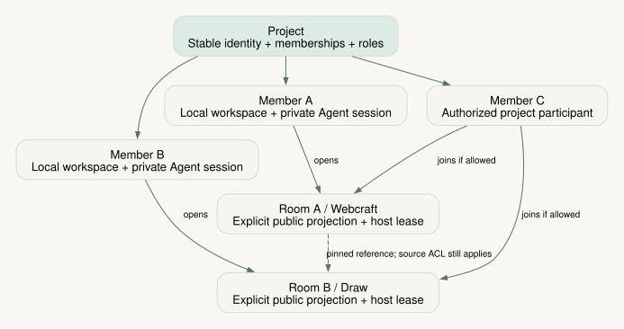
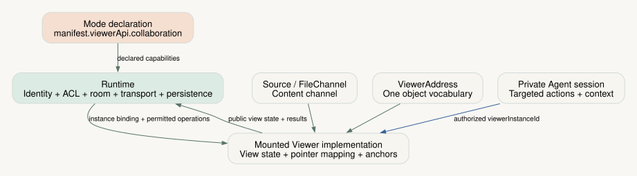
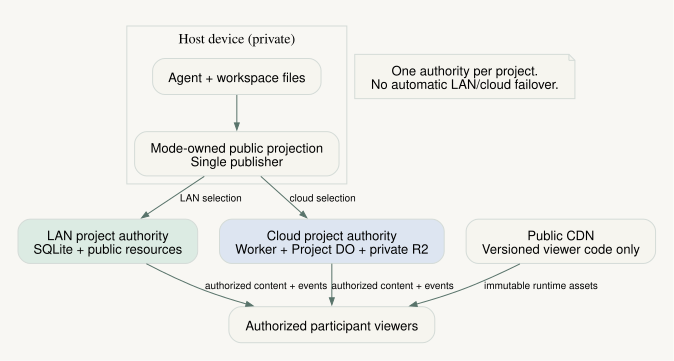
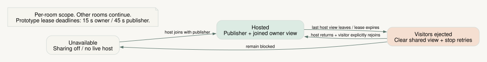

# Project collaboration architecture — 4.0 proposal

**Status: IMPLEMENTATION AUTHORIZED · 2026-10-14 · baseline: 3.57.3 plus the isolated collaboration prototype.**
The owner approved implementation with Webcraft as the only first-wave mode. Other modes receive compatibility analysis only. This is the implementation brief and acceptance bar, not a 4.0 release claim or an accepted ADR.
Read with the [user stories](2026-10-14-project-collaboration-user-stories.md) and the [prototype evidence](../reference/project-collaboration-experiment.md). The English proposals are authoritative; the visual review summary is a derivative.

## Review summary

- A Project connects people and their workspaces. Each person keeps their own local files and private Agent sessions; shared rooms expose explicitly published work through the existing mode viewer.
- Collaboration extends the established User ↔ Viewer ↔ Agent protocol. It does not introduce a second viewer, a second object-address vocabulary, or shared Agent chat.
- LAN and cloud use the same authorization and room semantics. Exactly one selected authority owns a Project's collaboration metadata; local files remain the authority for working content.
- The first integrated slice supports observation, pointers, following, comments, room chat, and safe publication. Arbitrary same-file multi-Agent merging and remote Agent execution are outside it.
- At the design baseline, prototype evidence covered presence, durable discussion, publication fencing, resource grants, hibernation, and host-offline ejection. The implementation is now described by the [authority contract](../reference/project-collaboration-authority.md), [viewer protocol](../reference/viewer-agent-protocol.md), and [local import contract](../reference/collaboration-reference-import.md). Verified accounts and collaboration implementations for other modes remain outside the approved first wave.



## 1. Domain and ownership

| Concept | Identity and owner | Contract |
|---|---|---|
| Project | Stable project ID; selected project authority | Membership, roles, room directory, shared discussions, accepted publication records and references. A local root path is not a cloud identity. |
| Local workspace | Stable workspace ID; one user and their local filesystem | Working domain files. Another administrator does not acquire filesystem or Agent access by managing the Project. |
| Private Session | Existing Pneuma session ID; its user | Backend process, conversation, tool calls, permissions, terminal, credentials and private viewer context. Preserve existing path-resolution rules. |
| Room | Stable registration ID bound to workspace, owner and mode instance | Explicit opt-in sharing of a running mode instance. It is neither the mode type nor the private Session transport. A resumed instance may reuse its registration after validation. |
| Viewer instance | Runtime-issued ID per mounted browser view | Independent selection, navigation, camera/playhead and Agent-action target. Multiple tabs of one user remain distinct. |
| Publication | Room ID plus immutable revision and manifest digest | Public Source projection and resource bytes accepted together. A publication is not a copy of the complete workspace. |
| Reference | Destination record pointing to source workspace/room, revision and ViewerAddress | A pinned relationship, not a permission grant or automatic live dependency. |

US-01–US-04 establish this model. Initially, one user's existing Session supplies a workspace's publication; do not migrate private files or infer shared roots merely to enable a room.
The current cloud deployment has one fixed `PROJECT_ID` and one room. Formal integration must add an authorized project directory and room registration; the prototype's configuration is not a multi-project identity model.
An authority may retain a room's registration and discussions while its owner is absent. Retention does not make the room remotely accessible.

### Roles and access

| Actor | View / follow | Durable discussion | Content and management |
|---|---|---|---|
| Project reader | Authorized rooms and member discussions | None: no comment, reply, resolution or chat write | No content, invitation, membership or room mutation |
| Project writer | Authorized rooms | Comments, replies, resolution/reopen and room chat | Edit/publish their own local work; manage their own room's sharing |
| Project administrator | Authorized rooms | Same as writer | Project membership and sharing registrations; no implicit access to another user's local files or Agent |
| Anonymous view guest | One invited room; comments may be read | None; room chat is not exposed | No source, project directory or management access |
| Explicit comment guest | One invited room and its discussion | Create/reply to comments and send chat | No resolve/reopen, source edit, invitation or management |

Reader means no durable Project mutation; ephemeral presence and private browser UI preferences do not change Project data. Guest discussion is an explicit invitation capability, never a promotion of the reader role.
The prototype's bearer links and self-entered names test access rules, not verified account identity. Keep bootstrap authorization, member identity, publisher credentials, invitation redemption and resource grants separate.
The LAN lab's broad writer source editor is not the target ownership policy: integration must restrict content mutation to the caller's authorized local workspace.

## 2. Extend the existing six directions



| Existing direction | Preserve | Additional collaboration rule |
|---|---|---|
| User → Viewer | Selection, navigation, direct interaction | Scope to the actor's viewer instance; local input exits following. |
| Viewer → User | Typed Sources render Agent work | A remote viewer receives only the declared public projection. |
| User → Agent | Intent, attachments and selected-object context | Route to that user's private Session; room chat is a different channel. |
| Agent → User | Responses, permission requests and locator cards | Keep private. A user may explicitly share a public artifact reference. |
| Agent → Viewer | Declared actions, capture, request/result | Target an authorized viewer instance; do not broadcast to room participants. |
| Viewer → Agent | extractContext and onNotifyAgent | Use the user's local context only. Peer navigation, follow, comments and render notifications never wake another person's Agent. |

`ViewerAddress` remains the single object reference for selection, comments, references, locator cards, navigation and capture. Modes own its vocabulary; `contentSet` retains its existing framework meaning.
Reuse `navigateRequest` and `onNavigateComplete(result)`, including request sequencing, loading acknowledgement and visible failure. A missing target stays unresolved; never silently point at the current page instead.
Reuse `ViewerActionResult` for apply failures. Reuse a mode's existing navigation/action implementation internally, not the private Agent socket or arbitrary remote action dispatch.

### Capability declaration and runtime binding

Add a pure-data `manifest.viewerApi.collaboration` declaration. Viewing, pointers, follow and address anchors are separate opt-ins; missing capabilities remain unavailable.
A declared capability, a working mounted implementation, and the current actor's permission are three different facts. The shell enables an operation only when all three, plus the room's current lifecycle, allow it.
Bind runtime functions through optional `ViewerPreviewProps` for each mounted viewer. Never put participant state or mutable adapters on the shared `ModeDefinition.viewer` singleton.

**DRAFT SHAPE — illustrative, not implemented or a frozen ABI.** Existing types are reused; JSON payloads must be bounded and validated at runtime.

```ts
interface ViewerCollaborationDeclaration {
  viewing: true;
  pointers?: true;
  follow?: true;
  addressAnchors?: true;
}
interface ViewerViewState {
  address: ViewerAddress;
  detail?: Record<string, unknown>; // JSON-only, mode-defined camera/time/scroll
}
interface ViewerCollaborationAdapter {
  applyView?(view: ViewerViewState, signal: AbortSignal): Promise<ViewerActionResult>;
  projectPointer?(value: Record<string, unknown>): Projection;
  projectAnchor?(address: ViewerAddress): Projection;
}
type Projection = { status: "visible"; x: number; y: number }
  | { status: "offscreen" | "unresolved" };
interface ViewerCollaborationBinding {
  viewerInstanceId: string;
  register(adapter: ViewerCollaborationAdapter): () => void;
  reportView(view: ViewerViewState, cause: "local-input" | "follow" | "content-refresh"): void;
  reportPointer(value: Record<string, unknown> | null): void;
  // Runtime supplies authorized peer state and comment anchors to this instance.
}
// ModeManifest.viewerApi.collaboration?: ViewerCollaborationDeclaration
// ViewerPreviewProps.collaboration?: ViewerCollaborationBinding
```

The runtime stamps actor, room, instance, content revision and ordering metadata; it does not trust an actor ID inside mode payloads. Registration checks the hooks required by the declaration. A missing hook or incompatible payload produces an unavailable capability with a diagnostic, not silent fallback.
Registration belongs to one mount generation; unregistering cancels pending applications and invalidates its callbacks. Projection coordinates are CSS pixels relative to that instance's viewer overlay, not screen pixels. The mode invalidates projections after layout, resize, content or camera changes. Local input exits following; reports caused by follow never become new local intents.
Modes encode semantic view/pointer state and project remote pointers/anchors into their own rendered geometry. The framework owns ACL checks, room lifecycle, connection routing, persistence, publication validation and transport.
Address-anchor creation uses existing `onSelect` output. Comment activation uses the existing navigation acknowledgement; `projectAnchor` only locates an overlay and does not invent another navigation protocol.
Follow applies the latest compatible state after the addressed content revision is available. Superseded work is cancelled; its late acknowledgement cannot certify a newer request. Remote application does not echo as a new local intent.

### Sources and permissions are independent of view state

Content continues through `Source<T>` and `FileChannel`: subscription-driven reads, origin-tagged events, serialized writes within an instance, and write completion only after the committed value is delivered.
The remote transport must preserve those semantics where writing is supported. A Source queue is not a distributed lock; native Agent file writes remain independent and require explicit version/conflict handling at publication boundaries.
Pointers, selections, view state and following are ephemeral, latest-value data per viewer instance. They do not advance a content revision, save domain files, enter undo history, or use the durable content-write queue. A memory Source may expose them without changing those semantics.
`readonly` means replay restrictions and suppresses selection/annotation; `editing` means the Session's authoring/consumption lifecycle and can affect Agent startup. Neither is an individual collaborator's ACL. Keep content-write, discussion and private-Agent permissions separate; enforce them server-side as well as in controls.

### Mode validation, not a Webcraft-shaped framework

| Mode | Semantic view | Objects and adapter obligations |
|---|---|---|
| Webcraft | Content set, page, query/hash, viewport preset and scroll anchor | Reuse page/selector addresses; preserve navigation load acknowledgements and sandbox isolation. |
| Draw | File and Excalidraw camera: scrollX, scrollY, zoom | Reuse file/elementId; project canvas coordinates. Following must not persist the camera as a document edit or add undo entries. |
| Bansho | Board/notes view, semantic section/step, playhead, playback state/rate and camera | Reuse its address vocabulary; distinguish following a participant from following the growing board. Positional fallbacks are revision-aware. |

The approved first wave implements Webcraft only. Inspect Draw and Bansho as compatibility probes without changing their viewers or enabling collaboration. Broader mode support and a frozen multi-mode ABI require a later validated implementation. Unsupported modes keep their existing local behavior.

Source inspection supports the following later adaptations; neither is enabled
or claimed as verified collaboration support:

- **Draw:** `DrawPreview.tsx` already consumes a file Source and produces
  `{file, elementId}` addresses. A mounted adapter can represent camera position
  and zoom in `detail`, project scene points into overlay pixels, and resolve
  element IDs. Existing navigation acknowledges before a newly selected canvas
  is ready, so collaboration must add a real readiness/result boundary. Its
  `useStore` imports and module-level capture registration must be removed from
  the public path. Camera application must bypass the edit/save/user-action
  path; the scene file and embedded images need an explicit public projection.
- **Bansho:** the aggregate `Board` Source and `{contentSet, section, step}`
  addresses already provide domain objects. A view can carry playhead time and
  paused/playing intent in `detail`; `useBoardPlayer` owns the local clock.
  Following must remain distinct from the player's existing live-tip follow
  behavior. Cross-board navigation already refuses foreign sets in action
  paths, which fits explicit scope validation. Public hosting must replace
  private store/hydration dependencies and direct `/api/session/capture`
  effects, then declare board text, theme, illustrations, narration and fonts
  together. Playback timing and changing schedules require a separate browser
  validation pass; serializable state alone is not evidence of synchronized
  playback.

These concrete gaps fit the existing mounted binding and publication seams.
They do not justify adding canvas or timeline concepts to the shared protocol.

### Placement-independent viewer and ownership

The same viewer implementation consumes Sources, resource resolution and its
per-mount collaboration binding in LAN and cloud deployments. It never reads an
authority URL, credential, transport kind or local workspace path. Runtime
services own those details and expose only connection, permission and hosting
outcomes. Publication adapters have the same placement-independent boundary.

Stable identities identify the project, principal, workspace and running mode
instance independently of local paths, ports, backend sessions and storage
providers. A workspace has an owner and a separately described runtime placement.
A future cloud workspace can therefore use the same publication and viewer
contracts; moving execution does not redefine ownership. This wave does not
build hosted Agent execution, verified account login, tenant billing or a complete
SaaS security product. Existing reader restrictions, private Agent isolation,
explicit sharing, host gating and revocation remain required behavior.

## 3. Publication and topology



| Responsibility | LAN deployment | Cloud deployment |
|---|---|---|
| Collaboration authority | Selected local Project service and durable store | Project Durable Object and durable store |
| Working content | Each owner's local filesystem | Each owner's local filesystem |
| Accepted resources | Immutable local content store | Private R2 content store |
| Publisher | Local workspace publisher, fenced per room | Outbound publisher connection, fenced per room |
| Viewer delivery | Local host serving compatible mode assets | Versioned public CDN/runtime assets plus authorized private resources |

Each Project selects one authority; do not run independent LAN and cloud ACL/discussion writers and attempt implicit synchronization. A LAN client may reach a cloud authority through a local bridge without creating a second authority.
Changing authority is an explicit stopped-and-verified migration with new credentials and no concurrent writers. This proposal does not require seamless authority failover.
In both deployments, a room is available only while its designated owner has a joined live view and its workspace publisher is live. Another administrator or publisher alone cannot hold it open. Hosting is per room: an offline owner never closes a different owner's healthy room.
This independence assumes the selected Project authority remains reachable. Losing the LAN authority machine/service makes every dependent room unavailable, even if their individual publishers remain healthy. Authority recovery never authorizes a competing writable fallback.

### Explicit public projection

A mode-owned publication adapter declares which Source keys, configuration fields and resource paths may leave the workspace. Keep server-side projection code in a mode module without React; shared runtime code validates its output.
The adapter produces serializable public Source values plus an explicit resource manifest and a schema/version stamp. It does not serialize Source functions, arbitrary FileChannel snapshots, local paths, private Session files, secrets or Agent messages.
Default publication is empty until declared. Source key allowlisting alone is insufficient when a value contains private fields: the adapter must project those fields and enumerate referenced resources explicitly.
Resources upload before publication. The authority verifies hashes, existence, limits and the publisher lease, then commits one immutable manifest with its Source values. Clients switch only to a complete accepted revision; a partial build leaves the previous revision visible with a publication error.
The publisher lease fences stale publishers; an operation ID independently deduplicates retries. Immutable publication is not a transaction over unrelated native filesystem writes. A mode needing atomic multi-file output must expose a stable export/checkpoint boundary.

### Existing viewer build and delivery

Full mode viewers use `snapshot/mode-build.ts::buildModeViewer`, its host ABI validation and the existing mode catalog's core compatibility and archive hashes. Do not add a parallel compiler for collaboration.
Pin core version, mode version, viewer artifact hash and publication schema in the room/publication compatibility record. Serve immutable public runtime bytes separately from private room resources; a cached viewer bundle conveys no content access.
The remote shell supplies one compatible React/store/i18n host surface. Reusing the ABI must not expose the private Session store, terminal, credentials, proxy routes or Agent callbacks. Audit mode imports and direct runtime requests before enabling viewing support.
Build/ABI failure is visible and retryable without restarting the private Agent. An incompatible mode/revision remains unavailable rather than silently loading a different bundle.

## 4. State, lifecycle and recovery



| State | Authority / writers | Lifetime and failure behavior |
|---|---|---|
| Membership, invitations, room registration | Selected Project authority; authorized admin/owner operations | Durable. Recheck on requests, grants and connected sockets; protect the designated owner/recovery path. |
| Working files and private Session | Local owner, native Agent tools and authorized local Source writes | Local persistence. Publication failure never claims that a local write was undone. |
| Publications, comments, chat, operation receipts | Project authority; fenced publisher or authorized participant operations | Durable accepted state; bounded retention and explicit capacity errors. |
| Presence, follow and view state | Actor's viewer instance; authority validates and relays | Ephemeral. Disconnect/lease expiry removes it; reconnect obtains a fresh snapshot. |
| Hosting lease and grant epoch | Authority; validated owner/publisher traffic | Expire using server time; survive hibernation as needed. Offline transitions invalidate old resource grants. |
| Unread markers | Participant's local browser/view scope | Historical initial snapshots and own/duplicate events do not count; mark read only while the relevant panel is visible and focused. |

1. **Start:** resolve the existing Project/Session paths, authenticate the owner, validate mode publication/capabilities, register the room and establish a publisher lease. Private Agent startup remains its existing independent lifecycle.
2. **Open:** join an owner view; only then admit authorized peers to that room. Guests redeem invitations into separate room-scoped credentials. Each view receives its own instance identity and current compatible snapshot.
3. **Work:** local files drive publication; peer view state drives presence only. Comment/chat writes use actor-scoped operation IDs, and accepted events update readers. Capture and Agent context target the user's chosen private viewer instance.
4. **Lose host:** closing/leaving the last joined owner view or losing the publisher ejects all non-owner participants, including members and guests, from that room. Block future room reads/writes, redemption, upgrades and private assets; preserve stored data and owner recovery access.
5. **Resume:** owner and publisher return, the publisher rescans local content, and new grants are issued. Visitors manually rejoin; they do not poll a host-offline room indefinitely. Multiple owner tabs count together.
6. **Stop or revoke:** disable sharing, revoke an invite or remove membership using current ACLs; close affected connections and invalidate access. Removing a room registration does not delete someone's local workspace or private Session.

Shared Project removal first revokes authority-side access and unregisters shared rooms. Durable metadata/resource cleanup follows an explicit retention policy and reports incomplete cleanup; it never recursively removes members' local workspaces or private Sessions. Existing local project/session deletion remains a separate local action that Project administration cannot invoke remotely.
The prototype uses **15 seconds for owner-view leases and 45 seconds for publishers**, with server-timed heartbeats and deadline alarms. Treat these as provisional product constants, not universal network guarantees; validate background tabs and mobile suspension before release. Late messages cannot revive an expired lease.
Ordinary participant transport loss while host availability is unknown may show a clearly stale snapshot with mutations disabled. Confirmed host-offline ejection clears shared viewer/discussion state. Neither path promises offline mutation queues or recalls already delivered bytes.
After a lost operation response, retry the same operation ID to recover the receipt; a timeout is not proof of failure. If a local save succeeded but publication acknowledgement was lost, report both facts and reconcile the accepted revision. This is recovery, not compensation or undo.
Replay retains its current content-checkpoint semantics; it does not imply recorded participant-view history. A handoff starts or attaches to the recipient's private Session through existing handoff rules and carries only explicitly authorized public references, never the sender's conversation.

## 5. Pinned cross-workspace references — US-13

Proposed reference identity is `{ projectId, workspaceId, roomId, publicationRevision, address: ViewerAddress }`, with an explicit source label and destination owner. Resolving it requires current source authorization and a hosted source room; pinning grants neither.
The default is a reference without copied bytes. If its source is offline, revoked, deleted or incompatible, show the pinned identity and an unavailable/stale state; never silently resolve to the latest revision or use an unapproved offline source cache.
An explicit authorized materialization creates a destination-owned artifact with source attribution and pinned revision. Subsequent use follows destination permissions and retention; it is visibly a copy, not live source access. Revoking the source cannot retract bytes already copied under prior permission.
Within the same authority, pin creation reserves the required revision against retention eviction before committing the reference. If retention quota cannot accommodate it, fail visibly; do not create a dangling pin or silently unpin an older one. Unpin/delete releases that reservation.
Refreshing a pin is a new explicit operation: verify source access/hosting, resolve a complete revision, then atomically replace the destination reference and retention reservation. Cross-authority references and automatic dependency refresh are outside the first slice.

## 6. Foundation gaps to close before integration

| Existing seam | Concrete gap | Required change / evidence |
|---|---|---|
| `src/hooks/useViewerProps.tsx` | `onSelect` saves `address`, but the selection prop projection omits it | Preserve the canonical address round-trip; test selection → comment/locator/capture. |
| Persisted viewer state | State is currently Session-scoped | Scope independent browsing and follow to viewerInstanceId; demonstrate two tabs do not overwrite each other. |
| `server/ws-bridge-viewer.ts` | Action requests broadcast to Session browsers; first response wins | Authenticate actor and intended viewer instance; reject wrong-instance responses and preserve request sequencing. |
| Existing viewer props / host ABI | Direct store access, FileChannel and onNotifyAgent can bypass a superficial UI gate | Provide the authorized public host surface and deny privileged operations at their responsible boundary. |
| Prototype cloud/lab model | One configured Project/room, bearer identities, broad LAN writer saves | Introduce stable identities and per-room lifecycle; enforce own-workspace writes without exporting private Session state. |

The authoritative contract home remains `core/types/`; mode declarations instantiate capabilities, the shell binds each instance, and viewers/publication adapters implement domain behavior. Any implementation must update core contract tests, the maintained protocol/state references and the Project Guide contract table together.
The existing protocol, Source providers, watcher, mode builder and publication checks are the baseline. WebSocket plus one authority is sufficient for this slice. Add Yjs or another mature structured-edit implementation only when a mode has a concrete concurrent-edit contract; file observation alone does not justify a generic CRDT layer.

## 7. Implementation milestones and acceptance gates

| Milestone | Stories / deliverable | Acceptance before proceeding |
|---|---|---|
| **M1 — Project and private work** | US-01–US-04, US-11–US-12: stable identities, roles, own-workspace/Session mapping and explicit room registration in the normal shell | Reader cannot perform any durable mutation; writer cannot write another owner's files; guests cannot enumerate Project/Session data; two owners can independently share and stop rooms. |
| **M2 — Existing viewer integration** | US-04–US-08: per-instance binding, pointers, follow, anchors, discussion and private-Agent targeting; Webcraft only; Draw/Bansho compatibility analysis | Two browser instances browse independently; follow applies no document write/undo; local input exits; stale anchors fail visibly; capture reaches only its intended instance; unsupported capabilities remain disabled. |
| **M3 — Publication and deployment parity** | US-03, US-09–US-12: public projection, versioned viewer assets, equivalent LAN/cloud authority and lifecycle | Reject undeclared/private resources and incompatible bundles; preserve last complete revision on failure; test stale publisher fencing, idempotent retry, offline gates, 15s/45s expiry, hibernation, restart, multi-tab recovery and per-room isolation. |
| **M4 — Pinned references** | US-08, US-13: permission-checked references, explicit materialization and retention | A pin stays on its chosen revision; revoked/offline origins cannot be fetched; authorized copies stay labeled; quotas fail without dangling pins; explicit refresh is atomic. |

These milestones describe future integration, not work already delivered by the prototype. M1 needs a thin tested publication path to make room admission real; M3 completes its parity, failure and recovery gates before external rollout.
Every milestone requires core/server boundary tests and browser interaction/screenshot verification. Run relevant repository checks; mode integration requires the ordinary viewer build/ABI path. Measure Internet latency and larger workspaces separately rather than converting loopback prototype timings into service guarantees.
M3 also stops and restarts the selected authority with two active room publishers: no writable fork may appear; accepted ACLs, revisions and operation receipts must survive; participants receive an explicit outage and recovery/rejoin path.

## 8. Approved implementation choices

| ID | Decision | Implementation position |
|---|---|---|
| D1 | Stable identity and future account binding | Use durable principal, project, workspace and mode-instance IDs with provisioned credentials now. Verified login, tenant administration and SaaS account UI are deferred. Guest names remain self-reported. |
| D2 | First supported mode rollout | **Approved: Webcraft only.** Analyze Draw/Bansho compatibility without implementing them. |
| D3 | Reference materialization policy | Default to permission-checked pins; copying requires an explicit authorized action and visible revision attribution. |
| D4 | Protected pin retention and quota | Reserve pinned revisions, reject over-quota pins, and release reservations on unpin/delete; set product limits before rollout. |
| D5 | Host heartbeat grace under suspension | Start from the prototype's 15s/45s deadlines; measure background/mobile behavior and select the final grace policy without weakening per-room host gating. |

Existing decisions remain constraints: private Agent traffic, explicit room sharing, strict readers, separate comment invitations, own-workspace content writes, and owner-view-plus-publisher hosting. Implementation is authorized under these constraints; no ADR is accepted by this document.
