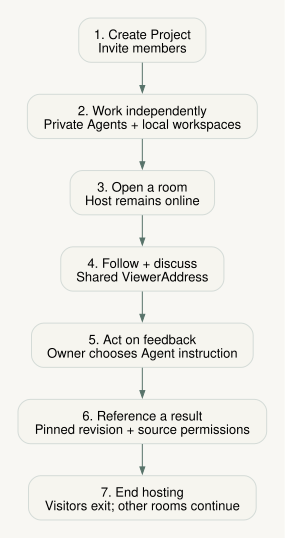

> Implementation approved for **Webcraft only**. Stable portable identities and
> placement-independent contracts are required; verified account login and the
> SaaS account product are deferred. Existing privacy, role and lifecycle gates
> remain acceptance criteria. Coverage labels below are the pre-integration baseline.

# Project collaboration 4.0 — user stories

Status: approved acceptance criteria for the Webcraft-first implementation.
The per-story status below records the pre-integration baseline. Current results
are recorded under [Integrated acceptance](#integrated-acceptance--2026-10-14).
Named accounts and multi-Agent convergence remain outside this slice. See the
[architecture proposal](2026-10-14-project-collaboration-architecture.md).

## Scope and delivery markers

Three project members each keep a local workspace and a private Agent. They share
selected running work instances, inspect each other's work, discuss objects, and
carry authorized references into their own work. Sharing does not expose an Agent
conversation or transfer control of another person's files.

| Milestone | Intended outcome |
|---|---|
| M1 | Named project membership, permissions, private workspaces, main-shell room opt-in |
| M2 | Generic viewer integration: browsing, follow, comments, chat, own-Agent targeting |
| M3 | Publication, host lifecycle, revocation, explicit LAN/cloud authority |
| M4 | Authorized pinned references across workspaces |

**Status terms:** Prototype = demonstrated only in the isolated experiment;
Integration = product integration still required; Unvalidated = a decision or
behavior lacks end-to-end evidence. Mixed labels identify partial coverage.
Milestones express dependencies, not dates. Same-file multi-Agent convergence is
later work; these stories do not promise automatic merging or collaborative undo.

## Permissions at a glance

All permissions are checked by the authority, including existing connections.
Project roles govern project effects; an administrator does not gain access to
another person's private Agent, terminal, credentials, or local filesystem.

| Action | Reader | Writer | Admin | View guest | Comment guest |
|---|---|---|---|---|---|
| View an available shared room; browse/follow | Yes | Yes | Yes | Invited room | Invited room |
| Read room discussions | Yes | Yes | Yes | Comments only | Invited room |
| Edit/publish project work | No | Own local work | Own local work | No | No |
| Comment/reply; send room chat | No | Yes | Yes | No | Invited room |
| Resolve/reopen comments | No | Yes | Yes | No | No |
| Enable sharing; issue/revoke room links | No | Own room | Any room | No | No |
| Manage members; remove rooms/project | No | No | Yes | No | No |
| Pin/materialize into project work | No | Own destination | Own destination | No | No |

Guests are separate principals, not project readers with hidden exceptions.
View invitations default to observation; comment invitations explicitly add room
discussion. Guest names are self-reported labels, not verified member identities.
Both guest classes lack the project directory and other rooms.

## Main scenario: three people working together

1. Ada creates a project and invites Bo and Chen as writers. Ada is its admin.
   Each connects a separate local workspace and continues with a private Agent.
2. Ada enables sharing for her running Webcraft instance; Bo and Chen share their own Webcraft
   instances. Other modes are compatibility analysis only in the approved first wave. Unsupported modes are hidden, and multiple
   instances of one mode remain distinct rooms.
3. Bo opens Ada's room, follows her page navigation, then scrolls locally to
   leave follow. Chen independently inspects the same revision. Neither moves
   Ada's view or receives her Agent conversation.
4. Chen anchors a comment to Ada's heading. Bo replies in room chat; Ada sees
   separate red unread counts. Ada reads the comments, asks her own Agent to
   revise the selected object, and publishes a complete new revision.
5. Chen locates the thread on the new revision. If the heading was replaced,
   the thread remains readable with a stale-anchor notice. Ada resolves it;
   Chen can reopen it when the issue returns.
6. Bo pins an authorized revision/address from Ada's work into his own workspace.
   The pin carries provenance and grants no source access. An explicit import
   creates a destination artifact; it is never presented as a live source.
7. Ada temporarily leaves collaboration while her workspace stays running.
   Participants leave her room and see host-unavailable status. Ada returns;
   Bo and Chen explicitly rejoin. Their own work and Agents continue throughout.

This is the acceptance journey for the integrated product, not a report that the
three-workspace scenario has already passed.

## Stories and acceptance

### US-01 — Join a project as an identifiable member

As a project owner, I want named members with explicit roles, so I can understand
who has access and who is responsible for shared work.

- **Given** a project, **when** an admin invites or changes a member, **then** the member has one stable identity and an explicit reader/writer/admin role.
- **Given** an active connection, **when** its member is downgraded or removed, **then** subsequent actions use the new permissions without requiring a refresh.
- **Negative:** typing a display name or opening a bearer test link does not establish a verified account; a guest cannot impersonate membership or remove the last admin.
- **Milestone:** M1. **Status:** Integration + Unvalidated; role enforcement has Prototype evidence, but verified login is deferred; stable identities and explicit ownership are required now.

### US-02 — Keep my workspace and Agent private

As a member, I want to work locally with my own Agent, so collaboration can help
my work without exposing my conversation or controlling another person's files.

- **Given** three members, **when** each opens the project, **then** each retains an independent workspace, Agent conversation, and local editing responsibility.
- **Given** a writer or admin, **when** they publish work, **then** the publication comes from their authorized local instance; comments on a peer's room do not write that peer's files.
- **Negative:** project authority grants no peer Agent prompts, history, terminal, credentials, permission dialogs, or arbitrary filesystem operations; readers cannot publish project writes.
- **Milestone:** M1. **Status:** Integration; the Prototype isolates its public host but does not connect three normal Agent workspaces.

### US-03 — Share one running work instance deliberately

As a writer, I want to enable collaboration for a chosen running instance, so I
can decide which work is visible and when it is available.

- **Given** an eligible running mode instance, **when** its owner enables sharing, **then** one room identifies that instance and its explicit public title; sharing starts off.
- **Given** unsupported or unavailable modes, **when** the sharing picker opens, **then** they are hidden; two supported instances of the same mode can be shared separately.
- **Negative:** selecting a mode type, opening a project, or starting an Agent does not silently publish a room; a stopped or unavailable host cannot offer a live room.
- **Milestone:** M1. **Status:** Integration; Prototype room opt-in exists for a separate Webcraft harness, not the normal mode-instance lifecycle.

### US-04 — Inspect a peer's work independently

As a member, I want to open a peer's shared work in a viewer, so I can understand
their progress while continuing my own task.

- **Given** current access and an online shared host, **when** I open a room, **then** I see its mode, publisher, revision, and current participants in an appropriate viewer.
- **Given** multiple viewers or tabs, **when** I browse or select an object, **then** only my viewer changes; my private selection remains separate from remote presence.
- **Negative:** opening a room does not subscribe my Agent to peer actions, change the publisher's viewport, or show other rooms to a room-scoped guest.
- **Milestone:** M2. **Status:** Prototype + Integration; independent Webcraft browsing exists, while normal viewers and multiple local workspaces require integration.

### US-05 — Follow a person, then resume my own browsing

As a viewer, I want to follow a participant's current view, so I can understand
their demonstration and stop following as soon as I explore for myself.

- **Given** a compatible room/revision, **when** I follow a viewer instance, **then** Webcraft follows its page/viewport/scroll through mode-owned semantics. Draw camera and Bansho timeline behavior are compatibility analysis, not first-wave deliverables.
- **Given** active follow, **when** I use local navigation, scroll, pan, or playback input, **then** follow ends visibly; remote updates do not create an echo or content edits.
- **Negative:** a missing target, incompatible revision, or unsupported view state produces an explicit paused/unavailable state; coordinates are never applied to the wrong content.
- **Milestone:** M2. **Status:** Prototype + Integration + Unvalidated; Webcraft follow is exercised, Draw/Bansho behavior remains unvalidated.

### US-06 — Discuss an object with a durable comment

As a writer, I want comments attached to visible objects, so feedback can be
located, answered, resolved, and revisited as the work changes.

- **Given** comment access, **when** I select an object and post, **then** the thread retains its ViewerAddress, creation revision, author, and fallback quote/position; replies preserve the thread.
- **Given** an authorized writer/admin, **when** they resolve or reopen a thread, **then** everyone sees the durable status; locating it uses the mode's address resolver.
- **Negative:** a removed or ambiguous target stays visible as stale/unresolved, never silently attaches elsewhere; readers cannot comment and comment guests cannot resolve/reopen.
- **Milestone:** M2. **Status:** Prototype + Integration; Webcraft threads exist, while generic addresses, changed-revision recovery, and other modes need validation.

### US-07 — Use room chat and trust unread counts

As a member, I want real room chat and exact red unread badges, so I can notice
new discussion without confusing history or my own messages with new activity.

- **Given** an initial history snapshot, **when** it loads, **then** unread starts at zero; two new peer messages while chat is hidden or the window is unfocused produce a red count of two, excluding my own messages and duplicates.
- **Given** separate chat/comment badges, **when** I read one panel while it is visible and its window is focused, **then** only that panel clears; a new comment reply counts once, while resolve/reopen alone does not increment it.
- **Given** a reconnect or same-tab reload, **when** history is restored, **then** known messages are deduplicated and newly missed peer messages count once within that room.
- **Negative:** readers cannot send, view guests cannot access room chat, and failed sends do not appear as successful messages; cross-device read synchronization is not claimed.
- **Milestone:** M2. **Status:** Prototype + Integration; room chat and tab-local unread logic have isolated coverage, not full product integration.

### US-08 — Bring an authorized reference to my own Agent

As a writer, I want to reference a shared object in my own conversation, so my
Agent can help with my task using context I deliberately choose.

- **Given** a selected shared object and current access, **when** I send a reference to my Agent, **then** its source, revision, and address remain explicit and only my conversation receives it.
- **Given** a private local capture request, **when** it navigates and captures, **then** it targets one designated viewer instance and reports arrival, failure, supersession, or timeout before returning a result. An immutable publication-scoped capture is explicitly unsupported in this slice and fails without dispatch; the current local rendering is never presented as proof of a pinned revision.
- **Negative:** remote cursors, comments, or follow updates do not automatically notify any Agent; a request cannot broadcast to peers and accept the first screenshot response.
- **Milestone:** M2. **Status:** Integration + Unvalidated; existing address/navigation/capture contracts can be reused, but collaboration-aware targeting is not implemented.

### US-09 — See complete revisions and honest publication failures

As a viewer, I want an identified, complete publication, so I know whether I am
seeing current work or the last successful revision.

- **Given** an online host, **when** changed work is accepted, **then** viewers receive one immutable revision and its complete resource manifest; failed or incomplete publication reports an error.
- **Given** publication failure while the host remains online, **when** a previous complete revision exists, **then** it may remain visible with its revision and failure state clearly marked.
- **Negative:** once the authority declares the host unavailable, the shared preview and discussion are closed; stored cloud bytes do not make the room independently available or claim a failed update succeeded.
- **Milestone:** M3. **Status:** Prototype + Integration; static snapshots and failure handling exist, while normal Sources and broader mode publication remain integration work.

### US-10 — Leave temporarily and rejoin explicitly

As a host, I want to leave collaboration without losing local work, so I can
pause availability and return with predictable participant behavior.

- **Given** a shared room, **when** it admits participants, **then** both its designated owner's joined live view and its workspace publisher must be present; another admin cannot substitute for that owner.
- **Given** a live room, **when** its last joined owner view leaves or its publisher becomes unavailable, **then** participants are removed and grants stop serving that room; other owners' healthy rooms and all local work/Agents continue independently.
- **Given** host recovery, **when** the room becomes available again, **then** previous participants see a manual rejoin action; returning the host does not silently rejoin them.
- **Given** an ungraceful disconnect, **when** host liveness expires, **then** the authority closes availability; the Prototype uses a 15-second owner-view deadline and 45-second publisher deadline, not a production availability guarantee.
- **Negative:** closing one of several joined owner tabs does not close the room, and participant departure does not stop the host; host departure does not delete files/comments/chat or trigger automatic room-rejoin loops.
- **Milestone:** M3. **Status:** Prototype + Integration; isolated host-offline/manual-rejoin behavior exists, with production lifecycle and lease tuning unvalidated.

### US-11 — Invite a visitor with an explicit capability

As a room owner, I want separate view and comment invitations, so I can invite
external feedback without adding project members or granting editing access.

- **Given** a new anonymous link, **when** no extra capability is chosen, **then** it grants only its room's view access; a comment invitation explicitly adds comments, replies, and room chat.
- **Given** invitation redemption, **when** a visitor enters a name, **then** their distinct guest identity is labeled as a self-reported visitor; expiry and revocation remain enforceable.
- **Negative:** comment access cannot edit content, resolve threads, manage sharing, browse membership, or enter another room; guest capability never upgrades a strict project reader role.
- **Milestone:** M3. **Status:** Prototype + Integration; cloud guest capabilities exist in the experiment, and verified member identity remains separate pending work.

### US-12 — Know the authority and remove access safely

As an admin, I want explicit authority and scoped removal, so access changes have
one meaning without unexpectedly deleting anyone's local work.

- **Given** LAN or cloud operation, **when** a project is opened, **then** its authority is explicit; cloud-backed local access uses cloud decisions, while LAN-only state does not silently fork or replace them.
- **Given** two healthy room publishers using one authority, **when** that authority stops and restarts, **then** both rooms report the outage without a writable fallback; accepted permissions, revisions and receipts survive, and recovery/rejoin is explicit. This differs from one room's host leaving while the authority stays online.
- **Given** member/link revocation or room/project removal, **when** it is accepted, **then** affected connections and future resource grants are invalidated; deletion clearly identifies the shared metadata being removed.
- **Negative:** removing a room/project never recursively deletes local workspace files or private Agent sessions; revocation cannot retract bytes already downloaded, and cloud failure does not authorize a writable LAN fallback.
- **Milestone:** M3. **Status:** Prototype + Integration + Unvalidated; room/member revocation has evidence, but complete project deletion and authority migration need validation.

### US-13 — Pin a reference across workspaces without widening access

As a destination writer, I want a pinned source reference, so I can build on a
specific peer revision while preserving attribution and access boundaries.

- **Given** source read access and destination write access, **when** I pin an object, **then** the pin records source workspace/room, immutable publication revision, and ViewerAddress; the default pin embeds no source bytes and grants no access.
- **Given** a pin, **when** I dereference or refresh it, **then** the authority rechecks current source access and host availability; revocation, deletion, or host absence yields an explicit unavailable reference, not an offline source fetch.
- **Given** an explicit authorized import, **when** bytes are materialized, **then** a destination-owned artifact retains attribution and follows destination permissions/retention; it is visibly a copy rather than a live source.
- **Negative:** pins do not expose private paths/Agent history, import implicitly, or become accessible merely because the destination is shared; source revocation cannot recall previously authorized copies.
- **Milestone:** M4. **Status:** Integration + Unvalidated; cross-workspace pins, materialization UX, and revocation tests are not implemented.

## Pre-integration coverage and review gates

| Stories | Existing evidence | Missing before product acceptance |
|---|---|---|
| US-01–03 | Isolated roles, public/private boundary, explicit room enablement | Stable provisioned identities; launcher/project integration; own-work publishing scope (verified login deferred) |
| US-04–06 | Webcraft presence, independent browsing, follow, comment lifecycle | Per-instance adapter in Webcraft; stable/stale address resolution; other-mode analysis only |
| US-07 | Real chat; deduplication, history baseline, own-message exclusion, tab reload tests | Main-shell UX; integrated multi-room notification review |
| US-08 | Existing ViewerAddress, navigation verdicts, capture composition | Preserve addresses through shell; target viewer instance; private Agent integration |
| US-09–10 | Static revisions, last-good error handling, host-offline/manual-rejoin checks | Normal Source publication; running-instance lifecycle; target-network liveness evidence |
| US-11–12 | Guest capabilities, revocation, cloud connector/authority prototype | Account binding; full project deletion; migration/recovery semantics |
| US-13 | Contract proposal only | Pin persistence, authorization, deliberate import, unavailable-source UX |

The lab's broad writer source-save endpoint does not establish the proposed
own-work-only publishing rule. Its Webcraft pixel/scroll model does not establish
generic mode support. Existing replay covers Agent/file checkpoints, not a
recorded participant-view timeline. Named authentication, cross-device unread,
offline collaboration, and same-file multi-Agent merging are not proven.

Review the journey and permission matrix first, then the architecture's ownership
and failure paths. Implementation acceptance requires the three-person scenario,
server-side negative cases, and browser evidence for every integrated viewer.

## Integrated acceptance — 2026-10-14

The Webcraft slice now runs through normal Project Sessions. LAN and cloud use
the same compiled mode viewer, Source projection, ViewerAddress vocabulary and
per-mount collaboration adapter. The cloud browser pass used local workerd with
real Durable Object and R2 bindings; this change has not replaced the deployed
prototype Worker or published a 4.0 release.

| Scope | Verified behavior |
|---|---|
| US-01–03 | Stable provisioned Project/member/workspace identities, owned room registration, explicit sharing, strict readers, and private Project API/WS/Vite listeners on loopback. A separate LAN authority is reachable by peers. |
| US-04–07 | Actual mode bundle in public and private hosts; independent browsing; page/query/hash/viewport/scroll follow; local input exits follow; semantic pointers and anchors; durable comments/chat and tab-local unread state. Two independent owner Sessions can host separate rooms; loss of one leaves the other available. |
| US-08 | Selection retains its address; a shared reference creates an editable identity-only draft in the user's composer. Private actions target one socket and mount, serialize navigation, and fence timeouts and late responses. Immutable publication capture is explicitly unsupported; local capture cannot stand in for a pinned revision. |
| US-09–12 | Complete atomic revisions, publication errors, per-room owner/publisher leases, explicit rejoin, room-only guest capabilities, revocation, and persistent Project removal. Browser deletion clears peers immediately, survives reload, and leaves local files intact. |
| US-13 | A writer without a published room pins another workspace's exact revision, selects a specific object, previews the older revision after the head advances, and explicitly imports byte-verified original resources with attribution. Source loss closes the preview while an already imported copy survives. Retry records survive panel remount and tab reload. Retention and quota tests cover pinned revisions and restarts. |

Browser fixtures used normal Sessions in viewing mode without launching paid
Agent processes. They exercised both Vite and production private shells, the LAN
service, and the cloud runtime. This is not a physical multi-computer latency test
or a production cloud deployment claim. Draw and Bansho received source-based
compatibility analysis only. Account login, cloud-hosted workspaces, cross-device
unread state, offline collaboration and same-file merging remain future work.

Maintained contracts: [authority](../reference/project-collaboration-authority.md),
[viewer protocol](../reference/viewer-agent-protocol.md), and
[explicit imports](../reference/collaboration-reference-import.md).
Browser evidence is saved under `output/collaboration-4.0/`, including pinned
preview, source-offline, cloud-follow and removed-Project screenshots and the two
successful end-to-end logs. Automated coverage lives alongside the core contracts,
Session/authority implementations, Webcraft adapter, public client and cloud worker.

Final local gates: `bun run test` passed 7,222 tests with 617 gated skips and no
failures (441 files, 142.53 seconds). The separate cloud workerd suite passed
27 tests and 564 assertions. Root and cloud typechecks, the main and cloud asset
builds, guidance validation and whitespace checks passed. These counts are
separate runs, not an aggregate. Disposable acceptance servers and browser
processes were stopped; their registry entries were removed while evidence and
fixture files were retained.
